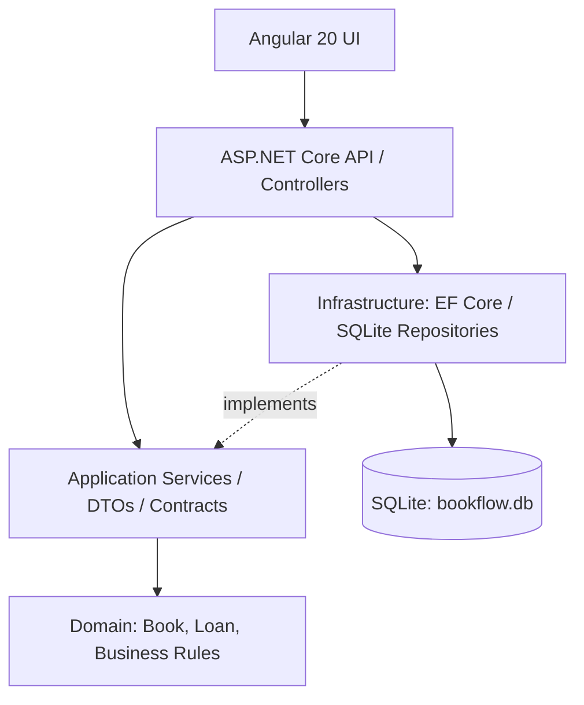

# BookFlow — .NET 8 + Angular 20

A full-stack library lending and inventory demo. The backend separates domain rules, application use cases, persistence, and HTTP delivery. The Angular client consumes the REST API and lets a user create books, register loans, list loans, and return books.

## Features

- List and register books with ISBN, author, and copy count.
- Display available vs. total copies.
- Create a loan only when a copy is available.
- Return a loan once and restore the available-copy count.
- Validate inputs and report business-rule errors as HTTP 400.
- Persist demo data locally using SQLite through EF Core.
- OpenAPI/Swagger interface for manual API verification.

## Architecture



### Layers and responsibilities

- `BookFlow.Domain`: entities and business invariants. It has no dependency on EF Core or HTTP.
- `BookFlow.Application`: DTOs, repository contracts, unit-of-work contract, and application services.
- `BookFlow.Infrastructure`: EF Core `DbContext`, SQLite setup, and repository implementations.
- `BookFlow.Api`: controllers, dependency injection, Swagger, CORS, seed data, and exception-to-HTTP mapping.
- `frontend/`: Angular standalone UI, API service, models, forms, and styles.

This demonstrates separation of concerns and dependency inversion: application services depend on interfaces rather than directly constructing EF Core repositories.

## Requirements

- .NET SDK 8.0 for the requested target framework.
- Node.js compatible with Angular 20: `^20.19.0`, `^22.12.0`, or `^24.0.0`; npm is included with Node.js.
- A modern browser.

**Version lifecycle note (19 Oct 2026):** .NET 8 support ends on 10 Nov 2026, and Angular 20 LTS ends on 28 Nov 2026. These versions are retained because the portfolio request explicitly targets .NET 8 and Angular 20. For a new project intended to remain maintained after those dates, plan an upgrade to a supported .NET LTS and Angular release, then rerun tests. See official lifecycle and compatibility references: https://learn.microsoft.com/en-us/dotnet/core/releases-and-support and https://angular.dev/reference/releases and https://angular.dev/reference/versions.

## Run the API

From the repository root:

```powershell
dotnet --version
dotnet run --project .\backend\BookFlow.Api\BookFlow.Api.csproj
```

The API uses SQLite and creates `bookflow.db` in the API working directory on first start, then seeds example books if the database is empty. Open Swagger at the URL shown by ASP.NET Core, usually `http://localhost:5080/swagger` after setting the URL, or `https://localhost:7xxx/swagger` if HTTPS is selected.

To pin the HTTP address for the Angular development client, run:

```powershell
$env:ASPNETCORE_URLS="http://localhost:5080"
dotnet run --project .\backend\BookFlow.Api\BookFlow.Api.csproj
```

## Run the Angular UI

Open a second terminal in the repository root:

```powershell
cd .\frontend
npm install
npm start
```

Open http://localhost:4200. The Angular API service targets `http://localhost:5080/api`. If you change the backend port, update `frontend/src/app/core/bookflow-api.service.ts`.

Because the user's existing Node.js version was previously `v13.14.0`, upgrade Node.js before installing Angular dependencies. Angular 20 does not support Node 13; use a version listed in the compatibility table above.

## API endpoints

| Method | Endpoint | Description |
|---|---|---|
| GET | `/api/books` | List books |
| GET | `/api/books/{id}` | Get one book |
| POST | `/api/books` | Register a book |
| GET | `/api/loans` | List loans |
| GET | `/api/loans/{id}` | Get one loan |
| POST | `/api/loans` | Create a loan |
| PATCH | `/api/loans/{id}/return` | Return a loan |

Example book request:

```json
{
  "title": "Clean Code",
  "author": "Robert C. Martin",
  "isbn": "9780132350884",
  "totalCopies": 3
}
```

Example loan request:

```json
{
  "bookId": "REPLACE_WITH_BOOK_GUID",
  "borrowerName": "Alex Rivera",
  "dueDateUtc": "2026-11-01T12:00:00Z"
}
```

## Business rules demonstrated

- Titles, authors, and ISBN are required.
- Total copies must be greater than zero.
- ISBN values must be unique in this demo.
- A loan cannot be created without an available copy.
- A due date must be in the future.
- A loan cannot be returned twice.
- Returning a loan restores the book's available count.

## Clean Code / SOLID examples

- **Single Responsibility:** controllers translate HTTP; services coordinate use cases; entities enforce state transitions; repositories manage persistence.
- **Open/Closed:** persistence can be replaced behind repository interfaces without rewriting domain rules.
- **Liskov Substitution / Interface Segregation:** small contracts define only the operations needed by each service.
- **Dependency Inversion:** application services rely on interfaces, with implementations injected by the API composition root.
- DTOs separate request/response models from persistence entities.

## Automated tests

The domain rule tests are included. Run them from the repository root:

```powershell
dotnet test .\backend\BookFlow.Domain.Tests\BookFlow.Domain.Tests.csproj
```

## Verification checklist

1. Start the API and open Swagger.
2. `GET /api/books` returns seeded books.
3. `POST /api/books` creates a new book.
4. `POST /api/loans` with an available book creates a loan and decrements available copies.
5. `PATCH /api/loans/{id}/return` marks the loan returned and increments available copies.
6. Try to create a loan when available copies are zero; expect a business validation error.
7. Try to return the same loan twice; expect a business validation error.

The project code is provided as a portfolio starter. Build and exercise it locally before telling a recruiter that all endpoints have been verified. No .NET SDK was available in the packaging environment, so an SDK build was not performed here.

## Security and production gaps

This demo has no authentication/authorization, member identity verification, overdue fine rules, migration management, concurrency strategy for simultaneous loans, structured production telemetry, CI pipeline, or production deployment. It uses synthetic data only. These should be addressed before using it outside a portfolio demonstration.

## Suggested improvements

- Add xUnit tests for domain and application services.
- Add EF Core migrations and optimistic concurrency control.
- Add authentication and policy-based authorization.
- Add pagination/search and an overdue-loan workflow.
- Add GitHub Actions for build and tests.
- Upgrade from .NET 8 and Angular 20 to supported versions, then re-run the complete test suite.
