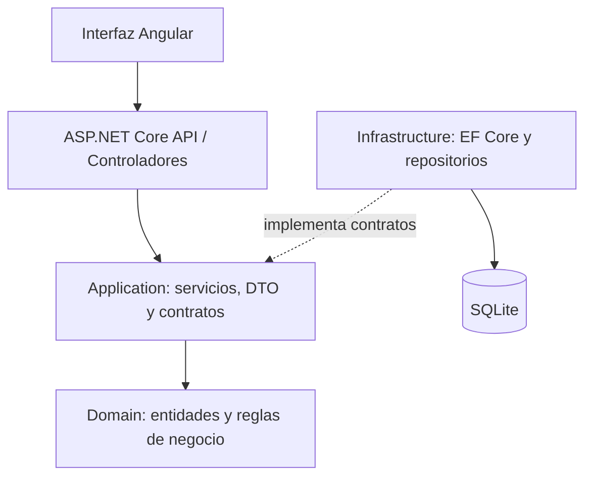

# BookFlow — .NET 8 + Angular 20

Aplicación de demostración para administrar un catálogo de biblioteca, controlar ejemplares disponibles y registrar préstamos y devoluciones. El objetivo del proyecto es mostrar cómo separar las reglas de negocio, los casos de uso, la persistencia y la entrega HTTP en una solución full stack.

> **Alcance:** proyecto personal de portafolio con datos ficticios. No es un sistema de biblioteca de producción. Ejecuta las pruebas y revisa los casos de uso en tu entorno antes de presentarlo como verificado.

## Funcionalidades

- Consultar y registrar libros con título, autor, ISBN y cantidad de ejemplares.
- Consultar el total de ejemplares y los que están disponibles.
- Registrar un préstamo si existe un ejemplar disponible.
- Registrar la devolución de un préstamo y actualizar la disponibilidad.
- Validar datos de entrada y reglas de negocio.
- Persistir los datos de demostración en SQLite mediante Entity Framework Core.
- Explorar y probar la API desde Swagger/OpenAPI.

## Tecnologías

- **Backend:** .NET 8, ASP.NET Core Web API, C# y Entity Framework Core.
- **Persistencia:** SQLite.
- **Frontend:** Angular 20 y TypeScript.
- **Pruebas:** proyecto de pruebas de dominio con .NET.

## Arquitectura



### Responsabilidad de cada capa

- `BookFlow.Domain`: entidades y reglas del negocio. No depende de HTTP ni de EF Core.
- `BookFlow.Application`: servicios de aplicación, DTO y contratos de repositorio.
- `BookFlow.Infrastructure`: `DbContext`, configuración de SQLite e implementaciones de persistencia.
- `BookFlow.Api`: controladores, inyección de dependencias, Swagger, CORS y conversión de errores a respuestas HTTP.
- `frontend/`: interfaz Angular, modelos, formularios y servicio para consumir la API.

La inversión de dependencias se refleja en el uso de contratos: la capa de aplicación trabaja con abstracciones, mientras que la infraestructura implementa el acceso a datos.

## Requisitos

- SDK de .NET 8.
- Node.js compatible con Angular 20 y npm.
- Navegador web moderno.

> **Compatibilidad:** Angular 20 no funciona con Node.js 13. Si tu equipo aún muestra `v13.14.0`, actualiza Node antes de instalar las dependencias. Consulta la matriz oficial de compatibilidad de Angular: https://angular.dev/reference/versions. .NET 8 se acerca al fin de soporte previsto para noviembre de 2026; para mantener el proyecto después de esa fecha, planifica una actualización a una versión soportada y vuelve a ejecutar las pruebas.

## Cómo ejecutar el backend

Desde la raíz del repositorio, abre PowerShell:

```powershell
dotnet --version
$env:ASPNETCORE_URLS="http://localhost:5080"
dotnet run --project .\backend\BookFlow.Api\BookFlow.Api.csproj
```

La aplicación configura SQLite y carga libros de ejemplo si la base de datos aún no contiene registros. Abre Swagger en:

`http://localhost:5080/swagger`

Si la URL configurada por ASP.NET Core es distinta, utiliza la que muestre la consola. El archivo `bookflow.db` se genera en la ubicación de trabajo de la API; no es necesario subirlo a GitHub.

## Cómo ejecutar el frontend

Abre una segunda terminal en la raíz del repositorio:

```powershell
cd .\frontend
npm install
npm start
```

Abre `http://localhost:4200`. El servicio del frontend está configurado para consumir `http://localhost:5080/api`. Si modificas el puerto del backend, ajusta `frontend/src/app/core/bookflow-api.service.ts`.

## Endpoints principales

| Método | Ruta | Descripción |
|---|---|---|
| `GET` | `/api/books` | Consultar libros |
| `GET` | `/api/books/{id}` | Consultar un libro |
| `POST` | `/api/books` | Registrar un libro |
| `GET` | `/api/loans` | Consultar préstamos |
| `GET` | `/api/loans/{id}` | Consultar un préstamo |
| `POST` | `/api/loans` | Registrar un préstamo |
| `PATCH` | `/api/loans/{id}/return` | Registrar una devolución |

Ejemplo para registrar un libro:

```json
{
  "title": "Clean Code",
  "author": "Robert C. Martin",
  "isbn": "9780132350884",
  "totalCopies": 3
}
```

Ejemplo de préstamo (reemplaza el identificador por uno real devuelto por la API):

```json
{
  "bookId": "REEMPLAZAR_POR_GUID_DEL_LIBRO",
  "borrowerName": "Alex Rivera",
  "dueDateUtc": "2026-11-01T12:00:00Z"
}
```

## Reglas de negocio demostradas

- Título, autor e ISBN son obligatorios.
- La cantidad total de ejemplares debe ser mayor que cero.
- El ISBN debe ser único en la demostración.
- No se puede prestar un libro sin unidades disponibles.
- La fecha de devolución prevista debe ser futura.
- Un préstamo no se puede devolver dos veces.
- Al registrar una devolución se recupera una unidad disponible.

## SOLID y código limpio

- **Responsabilidad única (SRP):** los controladores manejan HTTP, los servicios coordinan casos de uso, las entidades protegen las reglas y los repositorios gestionan la persistencia.
- **Inversión de dependencias (DIP):** los servicios trabajan con interfaces en lugar de instanciar directamente los repositorios EF Core.
- **Abierto/cerrado (OCP):** la persistencia se puede sustituir detrás de los contratos sin reescribir las reglas del dominio.
- Los DTO separan los modelos de solicitud/respuesta de las entidades de persistencia.

## Ejecutar las pruebas

Desde la raíz:

```powershell
dotnet test .\backend\BookFlow.Domain.Tests\BookFlow.Domain.Tests.csproj
```

## Lista de comprobación manual

1. Inicia la API y abre Swagger.
2. Comprueba que `GET /api/books` devuelve los libros de ejemplo.
3. Registra un libro con `POST /api/books`.
4. Crea un préstamo para un libro con ejemplares disponibles.
5. Devuelve el préstamo con `PATCH /api/loans/{id}/return`.
6. Intenta prestar un libro sin unidades disponibles y verifica la validación.
7. Intenta devolver dos veces el mismo préstamo y verifica que la operación se rechace.

## Limitaciones y próximos pasos

Esta versión no incluye autenticación/autorización, gestión de multas, control de concurrencia para préstamos simultáneos, telemetría de producción, pipeline CI/CD ni despliegue. Antes de usarla en un entorno real, habría que agregar migraciones, concurrencia optimista, pruebas de integración, controles de acceso y monitorización.

## Contexto del proyecto

Proyecto personal de portafolio para practicar y demostrar arquitectura por capas, separación de responsabilidades, reglas de negocio y desarrollo full stack. La versión publicada debe considerarse una demostración hasta completar la verificación local descrita arriba.
